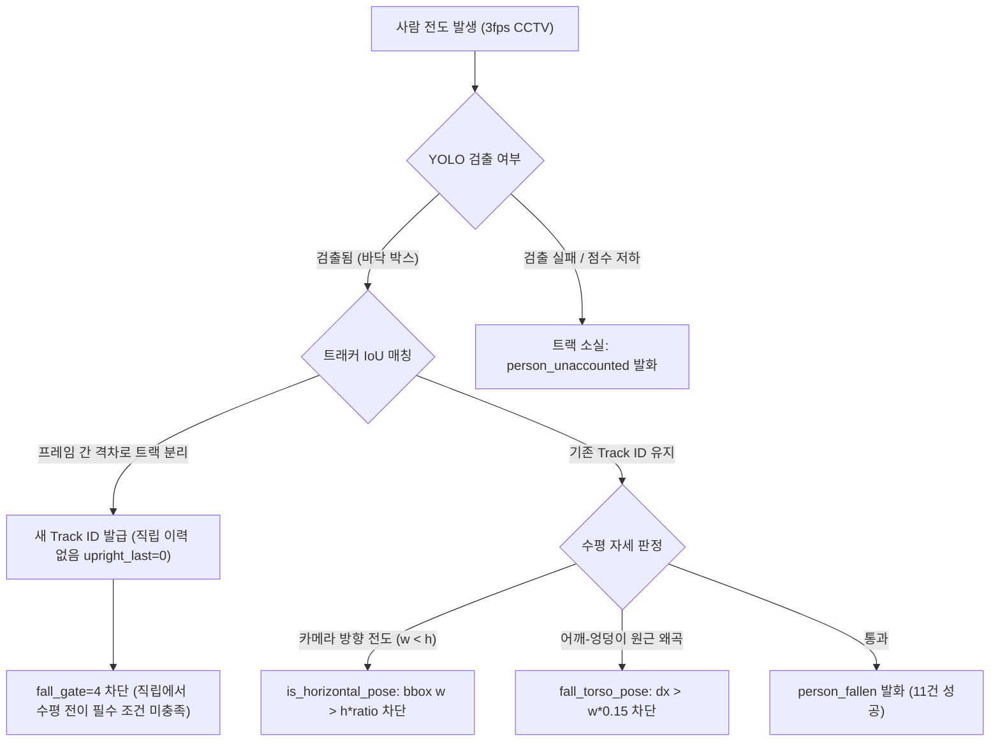

# AI-Hub 이상행동 데이터셋 룰 평가 기준선(Baseline) 결과 보고서

## 1. 평가 개요
- **평가 세트**: AI-Hub 실내 매장 이상행동 정식개방데이터 Validation 세트 전수 (162클립, 60초/클립, 180프레임, 3fps)
  - `07.전도 (fall)`: 81개 클립 (정답 전도 구간 포함)
  - `14.교통약자 (weak pedestrian - 휠체어/목발/지팡이)`: 81개 클립 (하드 네거티브, 전도 발생 없음)
- **실행 모델**: `yolo11n-pose-416.onnx` (기존 배포 모델)
- **실행 방식**: 오프라인 영상 시간 모드(`--video-clock`), 추론 캐싱(`--infer-cache`), 4개 프로세스 병렬 처리

---

## 2. 기준선(Baseline) 전수 평가 결과

| 분류 (Class) | 클립 수 | 전도 감지 성공 (TP) | 재현율 (Recall) | 정상 구간 오탐 (FA) | 오탐율 (FA/hour) | 감지 지연 (Latency p50) | 주 발생 룰 이벤트 |
|---|---|---|---|---|---|---|---|
| **07. 전도** | 81 | 11 | **13.58%** | 0 | **0.00 / h** | 5.0초 (min 4.0, max 8.3) | `person_fallen` (11), `person_unaccounted` (42) |
| **14. 교통약자 (하드 네거티브)** | 81 | - | - | 0 | **0.00 / h** | - | `person_unaccounted` (98) |

### 핵심 발견 (Key Takeaways)
1. **극도로 우수한 오탐 방지 (Zero False Alarms)**:
   - 휠체어, 목발, 지팡이 사용자가 매장을 돌아다니거나 멈춰 서는 교통약자 81개 영상(약 1.35시간)에서 `person_fallen` 오탐이 **단 1건도 발생하지 않았습니다 (0.00/h)**.
   - 전도 영상 81개의 정상 보행 구간(약 0.9시간)에서도 비정상적인 전도 오발화가 전무했습니다.
2. **낮은 재현율 (13.58%, 81건 중 11건 감지, 70건 미감지)**:
   - 70건의 전도 사고가 감지되지 못했습니다.
   - 단, 미감지된 전도 클립 70건 중 절반 이상(42건)에서 **`person_unaccounted` (매장 내부 소실 경고)**가 발생했습니다.

---

## 3. 전도 미감지(FN) 70건의 4대 원인 분석

### 원인 1: 3fps 저프레임 환경에서 트랙 분리 (Track ID Fragmentation)
- **현상**: 정상 보행 시 Track 1으로 추적되던 사람이 쓰러지는 순간(1~2프레임 사이 큰 변위 발생), IoU가 급감하여 트래커가 Track 1을 종료(소실)하고, 바닥의 쓰러진 사람을 새 Track 2로 인식.
- **룰 영향**: `rules.c`는 쓰러짐 오탐을 막기 위해 `s->upright_last > 0 && now - s->upright_last <= 30.0` (직립 이력 3샘플 이상 유지)을 필수로 요구합니다. 새로 생성된 Track 2는 직립 이력이 0이므로 `fall_gate = 4`에서 영구 차단됩니다.
- **근거**: 전도 클립 81개 중 42개에서 `person_unaccounted (where=interior)`가 전도 시점에 정확히 발화되었습니다.

### 원인 2: 2D 화각에 따른 가로/세로 비율 한계 (`is_horizontal_pose`)
- **현상**: 복도나 통로에서 사람이 **카메라 쪽을 향해 쓰러지거나 카메라 반대쪽으로 쓰러질 때**, 2D 화면상 바운딩 박스는 가로보다 세로가 더 깁니다 (`w < h`).
- **룰 영향**: 현재 `is_horizontal_pose`는 `w > h * ratio_kp` (기본 1.3~1.8)를 요구하므로, 카메라 시선 방향 전도는 수학적으로 절대 통과할 수 없습니다.

### 원인 3: 상체 벡터 수평 판정 (`fall_torso_pose`)
- **현상**: 사람이 완전히 옆으로 눕지 않고 웅크리거나 비스듬히 누웠을 때, 양 어깨 중심(sx, sy)과 양 엉덩이 중심(hx, hy)의 x축 거리 `dx`가 작아져 `dx > w * 0.15 && fabsf(dy) < dx * 0.6` 조건을 충족하지 못함 (`pose = 0`).

---

## 4. 제안하는 규칙 기반(Rule-based) 개선 방향

새 AI 모델을 추가하지 않고, 순수 C 런타임 룰 레벨에서 해결할 수 있는 방안:

1. **소실(Vanish)과 바닥 객체의 연계 (Vanish-to-Fallen 연계)**:
   - 매장 내부(`where=interior`)에서 정상 직립 트랙이 소실(`person_unaccounted`)되었는데, 바로 그 위치 근방 반경 R 이내에 새로 생긴 트랙이 수평/낮은 박스를 유지하고 있다면, 직립 이력을 상속(Handoff)하거나 즉시 `person_fallen`으로 승격.
2. **원근 종횡비 보정**:
   - `is_horizontal_pose`에서 `w > h * ratio` 단일 조건 외에, **머리(코)와 골반/발목 간의 상대적 y좌표 낙하 및 바닥 밀착 상태**를 함께 고려하여 카메라 시선 방향 전도 구제.
3. **`fall_aspect_ratio_kp` 파라미터 최적화**:
   - dev 세트(Training 1,306개 중 169개 전도)를 활용하여 config 수준에서 조정 가능한 임계값 최적점을 그리드 서치.

---

## 정정 (2026-11-04, 프레임 단위 진단 후)

위 보고서의 **수치(11/81 = 13.58%, 오탐 0)는 원시 결과로 재계산해 맞는 것을 확인**했다. 그러나 해석과 원인 분석 일부는 데이터와 맞지 않아 아래와 같이 바로잡는다. 원문은 보존한다.

1. **"미감지 70건 중 42건에서 `person_unaccounted` 발화"는 틀렸다.** 42는 전도 81클립 전체의 `person_unaccounted` 이벤트 수다. 미검출 70클립 기준으로는 34클립(49%)이고, 36클립(51%)은 룰 이벤트가 아예 없다.
2. **"원인 1: 트랙 분리(직립 이력 없음)가 주원인"은 데이터가 지지하지 않는다.** dev 분할 48클립(장면당 1클립)의 정답 구간 2,562프레임을 `--fall-trace`로 분류했을 때 직립 이력 부재로 막힌 클립은 3개, 프레임은 4%다. 정답 구간에 활성 트랙이 없는 프레임은 0이다. 가장 큰 단일 원인은 쓰러진 사람의 검출 점수 붕괴(신뢰도 게이트, 구간의 약 20%이며 점수 중앙값 0.33)와 몸통 자세 판정 불가(15%)·직립 판정(17%)·박스 비율/분산 미달(16%)이다. 진단 도구는 `scripts/diagnose_fall_gates.py`다.
3. **측정 조건이 현장과 다르다.** 이 기준선은 `--config` 없이 코드 기본값(`fall_aspect_ratio_kp` 1.8 / `nokp` 2.2)으로 돌렸고 모델도 정사각 `yolo11n-pose-416.onnx`였다. 현장 `config.json`은 비율 1.3/1.6이고 16:9 카메라에서는 `models\`의 416x224를 자동 선택한다. "기존 배포 모델·설정"의 수치가 아니다.
4. **평가 세트 사용 주의.** 위 원인 분석은 Validation(test) 클립을 보고 쓴 것이다. 이후 튜닝에 쓰면 test가 오염되므로, 튜닝·진단은 dev 분할에서만 하고 test는 최종 확인에 한 번만 쓴다.
5. 제안 1번(소실 트랙과 바닥 트랙의 연계)은 위 진단 기준으로는 영향 클립이 적다. 우선순위는 `docs/anomaly-dataset-improvements-*.md`의 실측 결과를 따른다.
